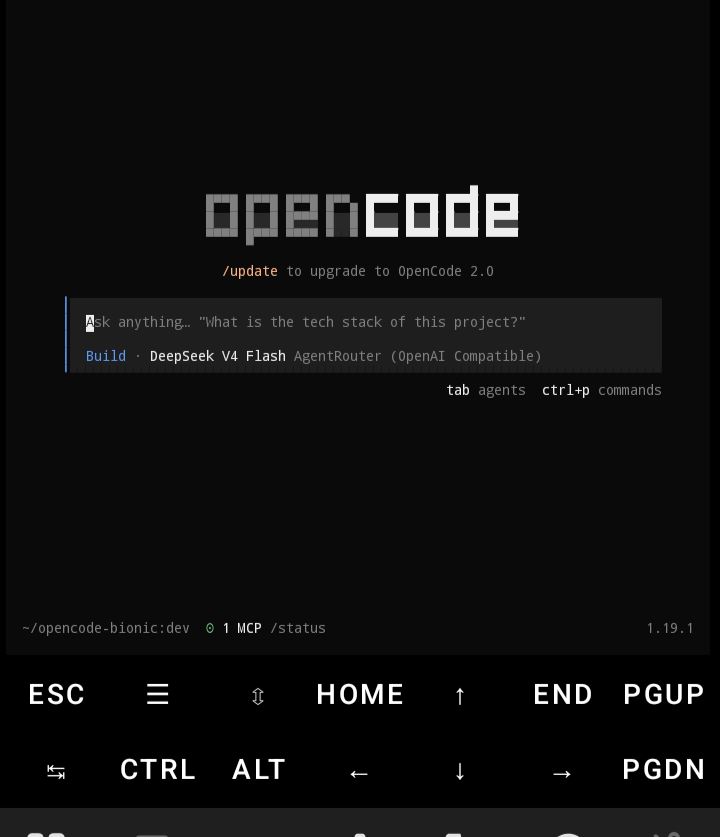
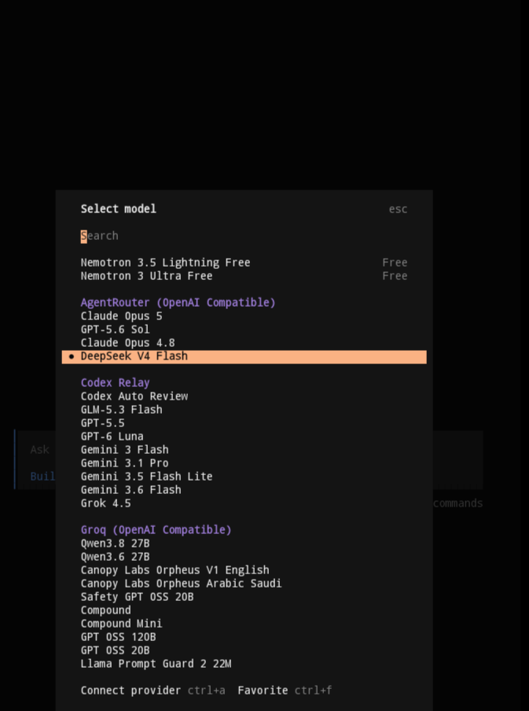

# opencode for Android — native Termux build

> Run [opencode](https://opencode.ai), the open-source AI coding agent,
> **natively on your Android phone**. No proot, no chroot, no Linux VM,
> no root. A Bionic-native aarch64 build, packaged for Termux.

[](https://termux.dev)
[](https://github.com/bd-loser/opencode-bionic/releases/latest)
[](https://github.com/bd-loser/opencode-bionic/releases)
[](https://github.com/bd-loser/opencode-bionic/actions/workflows/opencode.yml)
[](./LICENSE)
<!-- versions:badges -->
[](https://www.npmjs.com/package/@androidtui/core)
[](https://www.npmjs.com/package/@androidtui/core-android-arm64)
<!-- /versions:badges -->

## Screenshots

Native TUI, rendered on-device by Termux — no proot, no VNC, no WebView:

<p align="center">
  
  
</p>

Free models are in the picker too, so you can start coding without paying for
anything.

## Install

One command, inside [Termux](https://termux.dev) (F-Droid or GitHub — not
the Play Store build):

```bash
curl -fsSL https://raw.githubusercontent.com/bd-loser/opencode-bionic/main/install.sh | bash
```

Grabs the latest **stable** `.deb`, verifies its SHA256, installs with
`dpkg`. Then just run `opencode`.

### Or via `pkg` (signed apt repository, gets you `pkg upgrade opencode`)

Setup in one command — this adds the repository, installs opencode, and
every later `pkg upgrade opencode` pulls the newest build. Select a channel
with `OPENCODE_CHANNEL=beta` or `dev` before the pipe (default: stable):

```bash
curl -fsSL https://raw.githubusercontent.com/bd-loser/opencode-bionic/main/repo-setup.sh | bash
```

The script only automates the two commands below — run those instead if you
prefer not to pipe anything:

```bash
curl -fsSL https://bd-loser.github.io/opencode-bionic/opencode-bionic.gpg \
  -o $PREFIX/etc/apt/trusted.gpg.d/opencode-bionic.gpg
echo "deb [arch=aarch64] https://bd-loser.github.io/opencode-bionic stable main" \
  > $PREFIX/etc/apt/sources.list.d/opencode-bionic.list
pkg update && pkg install opencode
```

Every stable release (back to 1.18.x) plus recent beta/dev builds is in the
index, so version pinning works here too: `pkg install opencode=1.19.0`.
Swap `stable` for `beta` or `dev` in the `deb` line to follow another line —
pick one suite only, the package name is `opencode` in all of them. The index
is regenerated and re-signed automatically after every release.

### Channels

Upstream ships three release lines; we mirror all of them, automatically:

| Channel | Built from | Our tag pattern | Env |
|---|---|---|---|
| **stable** *(default)* | upstream release tags | `vX.Y.Z` | — |
| **beta** | upstream `beta` branch | `vX.Y.Z-beta.<sha8>` | `OPENCODE_CHANNEL=beta` |
| **dev** | upstream `dev` branch | `vX.Y.Z-dev.<sha8>` | `OPENCODE_CHANNEL=dev` |

```bash
curl -fsSL https://raw.githubusercontent.com/bd-loser/opencode-bionic/main/install.sh | bash
curl -fsSL https://raw.githubusercontent.com/bd-loser/opencode-bionic/main/install.sh | OPENCODE_CHANNEL=beta bash
curl -fsSL https://raw.githubusercontent.com/bd-loser/opencode-bionic/main/install.sh | OPENCODE_CHANNEL=dev bash

# pin an exact release (any channel) or an upstream commit
curl -fsSL https://raw.githubusercontent.com/bd-loser/opencode-bionic/main/install.sh | OPENCODE_VERSION=<version> bash
curl -fsSL https://raw.githubusercontent.com/bd-loser/opencode-bionic/main/install.sh | OPENCODE_COMMIT=<sha> bash
```

`/releases/latest` only ever points at **stable** — beta and dev builds are
prereleases and can never reach you unless you ask. Browse the artifacts
directly instead of installing: [all releases](https://github.com/bd-loser/opencode-bionic/releases)
· [beta & dev](https://github.com/bd-loser/opencode-bionic/releases?q=prerelease%3Atrue&expanded=true)
· [tags](https://github.com/bd-loser/opencode-bionic/tags). Everything is
automated: an hourly watcher detects new upstream moves and mirrors each
one, so a fresh dev build lands at most about an hour behind upstream.

## How it compares

[Hope2333/opencode-termux](https://github.com/Hope2333/opencode-termux) and
[guysoft/opencode-termux](https://github.com/guysoft/opencode-termux) also ship
native-Bionic OpenCode and both have bigger communities than this repo. What
is different here:

| | opencode-bionic | Hope2333/opencode-termux | guysoft/opencode-termux |
|---|---|---|---|
| libc | native Bionic | native Bionic | native Bionic |
| release lines | stable + beta + dev, built automatically from upstream | v1 + v2 | v1 + v2 side-by-side |
| dev freshness | tracks upstream commits hourly | — | — |
| terminal sessions (PTY) | works, bun-pty rebuilt for Bionic | — | — |
| what you install | one self-contained .deb | one of five package families | package + wrapper + libs |
| exact pinning | by version or upstream commit | — | — |

Blank cells: not verified, read their README.

## What is opencode?

An open-source, terminal-based AI coding agent — MIT-licensed and
model-agnostic (Anthropic, OpenAI, OpenRouter, local models via any
OpenAI-compatible endpoint). Developed at
[anomalyco/opencode](https://github.com/anomalyco/opencode), with prebuilt
binaries for macOS, Linux, and Windows — **but none for Android**.
This repo provides the Android line.

## Why a separate build is needed

opencode's TUI runs on [opentui](https://opentui.com), a native Zig
library. Upstream ships only glibc binaries; Android's Bionic linker
rejects them outright. This project assembles the three pieces that make
opencode run natively on Bionic:

- a **Bun runtime** patched for Bionic libc (SELinux-safe JIT, syscall
  traps, shebang remap, FFI paths),
- **opentui rebuilt for android-arm64**, published as `@androidtui/*`
  npm packages (16 KiB-page-aligned Bionic `.so`),
- **this repo**: the patch delta + version pins + release pipeline that
  ties it together and ships a single self-contained binary.

## Docs

- [Architecture & release pipeline](./docs/ARCHITECTURE.md)
- [Building on device / from source](./docs/BUILDING.md)

## Current pins

This channel's exact build inputs, regenerated automatically on every
release. Other channels live on their own branch
([beta](https://github.com/bd-loser/opencode-bionic/tree/beta) /
[dev](https://github.com/bd-loser/opencode-bionic/tree/dev)), all sourced from
[`versions.json`](./versions.json).

<!-- versions:table -->
| Component | Version |
|---|---|
| opencode (upstream) | `2.0.30` |
| `@opentui/{core,keymap,solid}` (JS, via `@androidtui`) | `0.5.17` |
| `@androidtui/core-android-arm64` (native `.so`) | `0.5.17` |
| `bun-termux` runtime | `1.4.3-patched` ([bd-loser/bun-termux](https://github.com/bd-loser/bun-termux)) |
| `bun-pty` (Bionic pty `.so`, embedded) | `0.4.8` ([release asset](https://github.com/bd-loser/bun-termux/releases/tag/bun-pty-v0.4.8)) |

<!-- /versions:table -->

## FAQ

<details>
<summary><b>Root needed? 32-bit? Which Android version?</b></summary>

No root, no proot, no chroot. Only aarch64 (arm64-v8a) is built, which
covers essentially every Android device from the last ~7 years. Minimum
Android version: 10 — the patched Bun runtime needs API 29.
</details>

<details>
<summary><b>Why not just `npm install -g opencode` in Termux?</b></summary>

Because it's broken: opencode pulls in `@opentui/core`, which loads a
glibc `.so` that Bionic refuses. This build substitutes the Bionic-native
`@androidtui/*` packages and compiles everything into one self-contained
binary.
</details>

<details>
<summary><b>Which LLM providers work?</b></summary>

All of upstream's: Anthropic, OpenAI, and any OpenAI-compatible endpoint
(OpenRouter, Groq, Ollama, …). Configuration is identical to upstream —
see [opencode.ai/docs](https://opencode.ai/docs).
</details>

<details>
<summary><b>How fast do updates land?</b></summary>

Automatically — upstream stable, beta, and dev activity each trigger a
matching build and release here within the hour. Version parity is a
design goal, not a task. See [Channels](#channels).
</details>

## Related repos

| Repo | Role |
|---|---|
| [bd-loser/bun-termux](https://github.com/bd-loser/bun-termux) | Bun runtime patched for Bionic (original) |
| [bd-loser/opentui](https://github.com/bd-loser/opentui) | opentui android-arm64 rebuild, publishes `@androidtui/*` (fork of [anomalyco/opentui](https://github.com/anomalyco/opentui)) |

Upstream credit: [anomalyco/opencode](https://github.com/anomalyco/opencode)
and [anomalyco/opentui](https://github.com/anomalyco/opentui).

## License

MIT — same as upstream opencode. See [LICENSE](./LICENSE).
